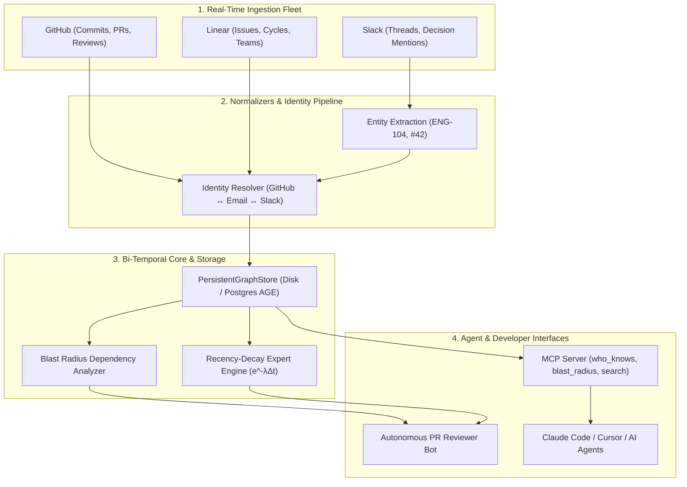

# 🌐 Open TeamGraph (`open-teamgraph`)

> **The Open-Source, Temporal & Agent-Native Teamwork Knowledge Graph.**  
> *A self-hostable, production-ready alternative to Atlassian Teamwork Graph (TWG) engineered specifically for AI coding agents and engineering teams.*

---

## ⚡ What Makes It Production-Ready?

Prototypes fail when they are ephemeral or only watch Git commits. Real engineering decisions happen in **Slack discussions** and **Linear/Jira tickets** long before code is committed.

**Open TeamGraph links the entire chain of work:**
1. **Multi-Source Ingestion**:
   - **GitHub**: Webhooks for commits, PRs, reviews, and modified files.
   - **Linear**: Webhooks for tasks, cycles, projects, and assignees (`Task -BLOCKS-> Task`, `Task -PART_OF-> Team`).
   - **Slack**: Events API ingestion with automatic regex entity extraction (linking `Message -REFERENCES-> Task` and `Message -REFERENCES-> PR`).
2. **Autonomous Cross-Platform Identity Resolution**:
   - Merges disparate developer identities (`octocat` on GitHub, `U123` on Slack, `alex@corp.com` on Git) into unified `Person` nodes.
3. **Durable Local-First Persistence**:
   - `PersistentGraphStore` provides automatic snapshotting and WAL recovery, persisting your graph state across process restarts without mandatory external database dependencies.
4. **Autonomous PR Blast-Radius & Reviewer Bot**:
   - Run `teamgraph audit --files <modified_files>` to generate a GitHub PR comment with recency-decayed expert recommendations, downstream service dependencies, and linked tasks.
5. **Native MCP Server**:
   - Direct integration with **Claude Code**, **Cursor**, **Devin**, and **Antigravity** via `@modelcontextprotocol/sdk`.

---

## 🏛️ System Architecture



---

## 📊 Feature Comparison Matrix

| Capability | Atlassian TWG | Faros CE | Apache DevLake | Spotify Backstage | **Open TeamGraph** |
| :--- | :---: | :---: | :---: | :---: | :---: |
| **Open Source** | ❌ | ⚠️ (Open Core) | ✅ | ✅ | 🟢 **100% MIT** |
| **Self-Hostable / Air-Gapped** | ❌ (Cloud only) | ⚠️ (Complex) | ✅ | ✅ | 🟢 **Zero external deps** |
| **AI Agent First (MCP Server)**| ❌ (Rovo only) | ❌ | ❌ | ❌ | 🟢 **Native MCP** |
| **Linear + Slack + Git Ingestion**| Jira/Bitbucket | Batch ETL | Batch ETL | Static YAML | 🟢 **Event-driven** |
| **Temporal Time-Travel** | ❌ | ❌ | ❌ | ❌ | 🟢 **Bi-temporal** |
| **Recency-Decayed Expert Finder**| Basic | ❌ | ❌ | Static Owner | 🟢 **$e^{-\lambda \Delta t}$ Math** |
| **Autonomous PR Audit Bot** | ❌ | ❌ | ❌ | ❌ | 🟢 **Included CLI** |

---

## 🚀 Quickstart

### 1. Run the Full Multi-Platform Demo
Clone and run immediately with [Bun](https://bun.sh) or Node.js:

```bash
cd open-teamgraph
bun install
bun run cli demo
```

Output:
```text
🌱 Seeding realistic engineering teamwork graph (GitHub + Linear + Slack)...
✅ Seeded nodes, edges, and persisted snapshot to disk.

🤖 Running Autonomous PR Blast Radius & Reviewer Bot for `src/auth/jwt.ts`:

## 🛡️ Open TeamGraph — Autonomous PR Review & Impact Analysis
### 🎯 Recommended Reviewers (Recency-Decayed Expertise)
- **Sarah Chen** (Score: `0.96`) — 1 commits, 0 reviews

### ⚠️ Downstream Blast Radius & Ownership
* **Impacted Services**: `payments-service`
* **Responsible Teams**: **Security Guild**

### 📋 Linked Tasks & Context
- [ENG-104] Upgrade token verification and rotators
```

### 2. Run Test Suite
```bash
bun test
```

### 3. Connect to Claude Code / Cursor via MCP
Add to your `claude.json` or Cursor MCP settings:

```json
{
  "mcpServers": {
    "open-teamgraph": {
      "command": "bun",
      "args": [
        "run",
        "c:/Users/DELL/Documents/antigravity/open-teamgraph/packages/cli/src/cli.ts",
        "serve"
      ]
    }
  }
}
```

### 4. Run PR Audit in CI/CD (GitHub Actions)
```bash
bun run packages/cli/src/cli.ts audit --files "src/auth/jwt.ts,src/gateways/stripe.ts"
```

---

## 🛠️ MCP Tools Reference

| Tool | Parameters | Description |
| :--- | :--- | :--- |
| `who_knows` | `target` (file path or URN), `limit` | Identifies top engineers and code reviewers with recency-decay scoring. |
| `blast_radius` | `target`, `depth` | Traverses downstream `DEPENDS_ON`, `MODIFIES`, and `PART_OF` dependencies. |
| `what_changed` | `since` (ISO date or `'7d'`, `'24h'`), `until` | Computes temporal diff of entities and edges created within a timeframe. |
| `query_graph` | `node_id`, `entity_type`, `as_of` | Inspects connectivity, neighbors, and historical state of the graph. |
| `search` | `query`, `limit` | Performs keyword and semantic entity lookup across tickets, code, and Slack. |

---

## 📄 License
MIT License. Created for the open-source engineering intelligence community.
